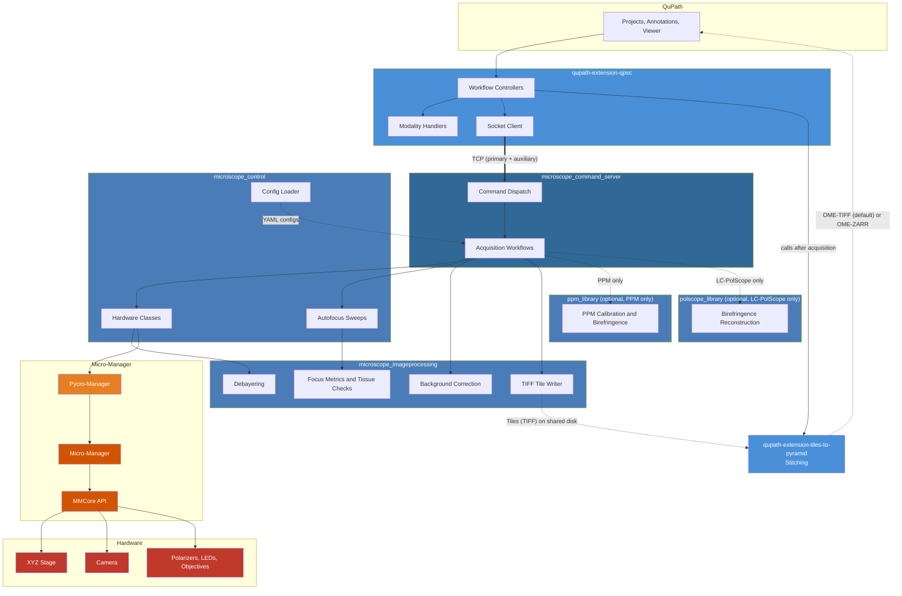
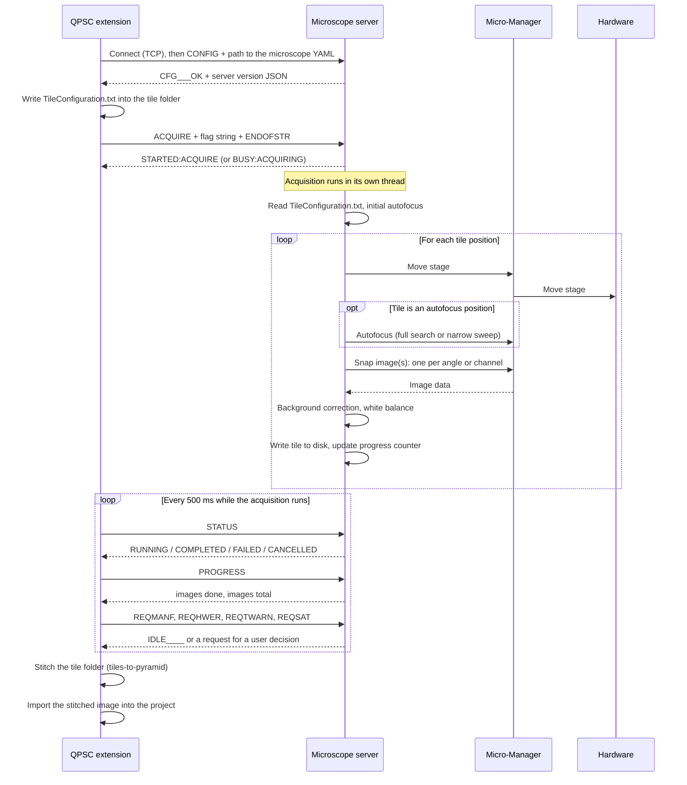

# QPSC Architecture

> [Back to README](../README.md) | [Developer Guide](developer_guide.md) | [Configuration](configuration.md) | [Troubleshooting](troubleshooting.md)

This page explains how the parts of QPSC fit together: the QuPath extensions, the Python microscope server, and Micro-Manager. It is written for contributors, and for facility staff who want to understand the system before installing or extending it. It assumes you know what QuPath, Micro-Manager and a motorized stage are. To install QPSC, see the [README](../README.md#installation). To set up a development environment, see the [Developer Guide](developer_guide.md).

Names used on this page: **QPSC** is the whole system. **The QPSC extension** is `qupath-extension-qpsc`. **The stitching extension** is `qupath-extension-tiles-to-pyramid`. **The microscope server** is `microscope_command_server`. **QuPath** means the host application only.

This page describes the `main` branches as of October 2026: `qupath-extension-qpsc` 0.10.0 and `microscope_command_server` 1.3.1, as given in their build files.

## Contents

- [The System at a Glance](#the-system-at-a-glance)
- [What Happens During an Acquisition](#what-happens-during-an-acquisition)
- [Socket Protocol](#socket-protocol)
- [Coordinate Frames](#coordinate-frames)
- [Modality System](#modality-system)
- [Configuration](#configuration)
- [Project and Metadata Model](#project-and-metadata-model)
- [Concurrency and Failure Model](#concurrency-and-failure-model)
- [Performance](#performance)
- [Design Decisions and Limitations](#design-decisions-and-limitations)
- [Future Directions](#future-directions)
- [References](#references)
- [Package Trees](#package-trees)

## The System at a Glance

Three programs run during an acquisition:

1. **Micro-Manager** drives the hardware through its device adapters. It has to be running first, because the microscope server will not start without it.
2. **The microscope server** (Python) attaches to Micro-Manager through Pycro-Manager, listens on a TCP port, and runs acquisitions.
3. **QuPath** runs with the QPSC extension and the stitching extension loaded. The QPSC extension connects to the microscope server.

The user draws a region in QuPath. The QPSC extension turns it into tile positions in stage coordinates and sends an acquisition command to the microscope server. The server moves the stage, focuses, captures and corrects each tile, and writes the tiles to disk. The stitching extension builds a pyramidal image from the tiles, and the QPSC extension adds that image to the QuPath project.

QuPath and the microscope server exchange commands over TCP. Tile images and tile positions travel through a folder on disk, so both programs must see that folder at the same path (see [Shared Filesystem](#shared-filesystem)).

Figure 1 shows the components and how they connect.



*Figure 1. Components by layer. Solid arrows are calls. The thick arrow is the TCP connection between the QPSC extension and the microscope server. Dotted arrows are files on disk or paths used by one modality only. Blue boxes are QPSC code, orange boxes are Micro-Manager, and red boxes are hardware.*

### Components

The table lists each component, where it runs and what it is responsible for. File-level trees are in [Package Trees](#package-trees).

| Component | Language | Runs in | Responsible for | Detail |
|---|---|---|---|---|
| `qupath-extension-qpsc` | Java | QuPath | Dialogs and workflows, coordinate transforms, modality handlers, the socket client, project import and metadata | [ARCHITECTURE.md](https://github.com/uw-loci/qupath-extension-qpsc/blob/main/documentation/developer/ARCHITECTURE.md) |
| `qupath-extension-tiles-to-pyramid` | Java | QuPath | Stitching tiles into a pyramidal OME-TIFF or OME-ZARR | [repository](https://github.com/uw-loci/qupath-extension-tiles-to-pyramid) |
| `qupath-extension-ppm` | Java | QuPath | PPM analysis: hue range filtering, polarity plots, perpendicularity analysis, batch processing | [repository](https://github.com/uw-loci/qupath-extension-ppm) |
| `microscope_command_server` | Python | its own process | Socket server, tiled acquisition, calibration commands, streaming autofocus | [repository](https://github.com/uw-loci/microscope_command_server) |
| `microscope_control` | Python | the server process | Hardware classes over Pycro-Manager, autofocus sweeps, YAML loading | [HARDWARE_ABSTRACTION.md](https://github.com/uw-loci/qupath-extension-qpsc/blob/main/documentation/developer/HARDWARE_ABSTRACTION.md) |
| `microscope_imageprocessing` | Python | the server process | Debayering, background correction, tile writing, focus metrics and tissue checks | [repository](https://github.com/uw-loci/microscope_imageprocessing) |
| `ppm_library` | Python | the server process on PPM microscopes; also run by `qupath-extension-ppm` | PPM calibration, birefringence images, fiber-angle analysis | [repository](https://github.com/uw-loci/ppm_library) |
| `polscope_library` | Python | the server process on LC-PolScope microscopes | Birefringence reconstruction and liquid-crystal calibration | [repository](https://github.com/uw-loci/polscope_library) |
| `microscope_configurations` | YAML | read by both sides | Per-microscope configuration files and the shared hardware table | [configuration.md](configuration.md) |

`SetupScope` is the QPSC extension's entry point. At startup it installs the preferences, loads and validates the microscope YAML (`QPScopeChecks`), and builds the `Extensions > QuPath SCope` menu. With no microscope configured it selects a bundled "Offline / Analysis" configuration, so analysis and project utilities work without hardware. Most menu items call `QPScopeController.startWorkflow(mode)`, and a few open their dialog directly.

The stitching extension has its own menu (`Extensions > Tiles to Pyramid`). It places tiles using one of four input strategies: filename coordinates, `TileConfiguration.txt` (the one QPSC acquisitions use), MicroManager metadata, or Vectra metadata. It composites output chunk by chunk through a bounded pool of open tile readers, can register tiles by content, and can merge per-channel stitches into one multichannel image. It does not touch the QuPath project.

`qupath-extension-ppm` has its own entry point (`SetupPPM`). It depends on the QPSC extension and uses its image metadata and alignment classes. Its Python analysis code is `ppm_library`, which it runs through an Appose service (`ApposePPMService`) inside QuPath, not through the microscope server.

### Python Package Dependencies

None of the Python packages is published on PyPI. Each is installed from its GitHub repository (`pip install git+https://github.com/uw-loci/<repo>.git`) or from a local clone (`pip install -e .`). `PPM-QuPath.ps1` does the first in production mode and the second in development mode; see the [setup scripts guide](../SETUP_SCRIPTS_README.md).

| Repository | Distribution name | Requires (lab packages) | Optional (lab packages) |
|---|---|---|---|
| `microscope_imageprocessing` | `microscope-imageprocessing` | none | none |
| `polscope_library` | `polscope-library` | none | none |
| `ppm_library` | `ppm-library` | `microscope-imageprocessing` | none |
| `microscope_control` | `microscope-control` | `microscope-imageprocessing` | none |
| `microscope_command_server` | `microscope-command-server` | `microscope-control`, `microscope-imageprocessing` | `ppm-library` (extra `ppm`), `polscope-library` (extra `polscope`) |

Because the packages are not on PyPI, pip cannot fetch one lab package as a dependency of another, so they are installed in dependency order. The steps are in the [Developer Guide](developer_guide.md#python-setup-editable-install).

The server's console command is `microscope-command-server`; it also runs as `python -m microscope_command_server.server.qp_server`. `ppm_library` provides the console commands `ppm-analyze` and `ppm-recompute-biref`, and `polscope_library` provides `polscope-scheme-check`.

### Terms

- **PPM**: polychromatic polarization microscopy, in which the orientation of birefringent fibers is encoded as hue. PPM is also the name of one microscope configuration.
- **Tick**: the unit of `rotation_angles` in a microscope configuration. One tick is one optical degree: the angle of the rotating polarizer, measured from the crossed position. The rotation stage driver in `microscope_control` converts it to device units. The separate word dates from the earlier PPM rotation mount, a Thorlabs stage geared 2:1, whose own scale moved two degrees for each optical degree.
- **LOCI**: the Laboratory for Optical and Computational Instrumentation, where QPSC is developed. A **LOCI hardware ID**, such as `LOCI_OBJECTIVE_OLYMPUS_10X_001`, names an entry in the shared hardware table `resources/resources_LOCI.yml`.
- **PPM, OWS3, LCPolScope, CAMM, Ocus40**: microscope configurations in `microscope_configurations`. Ocus40 is a slide scanner used as an image source.
- **BF, IF**: brightfield and immunofluorescence. **SHG**: second-harmonic generation. **LC-PolScope**: liquid-crystal polarized light microscopy.
- **JAI**: the 3-CCD prism camera, which has an exposure and gain per channel.
- **SIFT**: scale-invariant feature transform, used to match a microscope image against a slide-scanner image.
- **Appose**: the library `qupath-extension-ppm` uses to run Python inside QuPath.
- **Blosc**: the compression used for OME-ZARR output.

## What Happens During an Acquisition

The diagram follows one tiled acquisition from connection to import. The numbered steps below it describe the same sequence.



1. The user defines the region in QuPath: annotations on an existing image, or a bounding box in stage coordinates.
2. The QPSC extension computes the tile grid in serpentine order and writes `TileConfiguration.txt` into the tile folder.
3. The QPSC extension sends `ACQUIRE` with the folder location and the acquisition settings. The microscope server replies `STARTED` and acquires in a background thread.
4. The microscope server reads `TileConfiguration.txt` and runs an initial autofocus, with an optional focus survey. Then, for each tile position, it:
   - moves the stage
   - autofocuses, at a subset of positions only
   - snaps one image per angle (PPM) or per channel (fluorescence), or a single image
   - applies background correction and then software white balance, where enabled
   - writes the tile as `<index>.tif` in the angle or channel subfolder
   - on PPM acquisitions, writes a birefringence tile to the `<positive angle>.biref` folder. For each RGB channel it takes the normalized difference `(I+ - I-) / (I+ + I-)` between the positive-angle and negative-angle images, combines the three channels as a root mean square, and stores the result as a 16-bit single-channel image scaled 0 to 65535. The value is a unitless contrast, not a retardance in nanometers
5. The QPSC extension polls `STATUS` and `PROGRESS` every 500 ms until the server reports `COMPLETED`, `FAILED` or `CANCELLED`.
6. The QPSC extension calls the stitching extension, which stitches each angle or channel folder into a pyramidal OME-TIFF (the default) or OME-ZARR.
7. The QPSC extension adds the stitched image to the QuPath project and writes its metadata (sample name, XY offset, parent image).

### Where the Files Land

- **Tiles**: one TIFF per tile position per angle or channel, at `<projects folder>/<sample>/<scan type>/<region>/<angle or channel>/<index>.tif`. `TileConfiguration.txt` sits in the same region folder.
- **Stitched image**: pyramidal OME-TIFF (the default) or OME-ZARR with Blosc compression, chosen by the **Stitching output format** preference, written to `<projects folder>/<sample>/SlideImages/`.
- **After stitching**, the tiles are deleted, zipped or kept according to the tile-handling preference.

Saved tiles hold the pixel values after whatever processing the acquisition has enabled. Where the detector configuration asks for it, frames are debayered by bilinear interpolation when the camera layer snaps them; the PPM angle path snaps without debayering. The server then applies background correction (by division or subtraction, depending on the acquisition's background method) where it is enabled, and writes the tile. On angle acquisitions (PPM) it also applies software white balance, where enabled. LC-PolScope state tiles are saved without background division, because the reconstruction applies the background itself. Unprocessed frames are kept only on angle acquisitions with raw saving on, under `<scan type>/Raw/<region>/<angle>/`. Each tile stores a pixel size in its TIFF resolution tags (see [Pixel Sizes](#pixel-sizes) for which one).

The microscope server stitches nothing. Stitching runs inside QuPath, in the stitching extension.

### What Is Recorded for Each Acquisition

Each stitched image's project entry carries the metadata keys listed in [Project and Metadata Model](#project-and-metadata-model). The acquisition settings are kept in files beside the data:

- `acquisition_command_<timestamp>.txt`, in the tile folder: the full `ACQUIRE` flag string, saved by the QPSC extension for each acquisition.
- `acquisition_metadata.json`, in the tile folder: written by the microscope server at the end of the acquisition. It holds the angles and exposures or the channels, the white balance mode, the background method, the Z-stack and autofocus settings, timing and saturation summaries, and the versions of `microscope_command_server`, `microscope_control`, `microscope_imageprocessing` and Python.
- `<image stem>.stitch-info.txt`, beside each stitched image: the stitch record written by the stitching extension, to which the QPSC extension adds an `[acquisition]` section.
- The microscope server's session log, in a `logs/` folder beside the microscope configuration file.

When tiles are deleted or zipped after stitching, only the tile images are removed. The other files in the tile folder stay.

## Socket Protocol

The QPSC extension and the microscope server talk over TCP. This section gives the message format; the command and reply reference is [SOCKET_PROTOCOL.md](https://github.com/uw-loci/qupath-extension-qpsc/blob/main/documentation/developer/SOCKET_PROTOCOL.md) in the extension repository.

### Message Format

- **Commands** are 8 ASCII bytes, underscore-padded (for example `getxy___`, `acquire_`). The server looks the bytes up in `COMMAND_HANDLERS` in `microscope_command_server/server/handlers/__init__.py`. The Java side mirrors them in the `Command` enum in `MicroscopeSocketClient`. An unknown command is logged by the server and gets no reply.
- **Numeric payloads and replies** are big-endian.
- **Text payloads**: `ACQUIRE`, `BGACQUIRE` and the calibration and test commands send a `--flag value` string terminated by `ENDOFSTR`.
- **Connections**: the QPSC extension opens two TCP connections to the same port. The primary carries `CONFIG`, acquisitions and other long operations. The auxiliary carries Live Viewer frames and stage control so they keep working while the primary is busy. The QPSC extension sends `CONFIG`, with the path to the microscope YAML, first on each connection.
- **Defaults**: the server listens on all interfaces, port 5000. The QPSC extension connects to `127.0.0.1:5000` unless the host and port preferences are changed.
- **Progress** is polled. During an acquisition the client asks `STATUS` and `PROGRESS` every 500 ms; `PROGRESS` returns images done and images expected.
- **Errors**: when an acquisition fails, `STATUS` returns `FAILED: <message>` (up to 500 characters) and the QPSC extension shows that message.
- **Connection health**: when the connection has been idle for the health-check interval (default 30 s) the client reads the stage position, and reconnects if that fails. During an acquisition the status polling does this job.

Two exchanges as they appear on the wire:

```
Get stage position
  extension -> server   getxy___                      (8 ASCII bytes)
  server -> extension   8 bytes: X, Y as two big-endian 32-bit floats, in micrometers

Start an acquisition
  extension -> server   acquire_                      (8 ASCII bytes)
  extension -> server   --yaml ... --projects ... --sample ... --scan-type ... --region ... ENDOFSTR
  server -> extension   STARTED:ACQUIRE               (padded to 16 bytes)
```

### Shared Filesystem

Tile positions and tile images do not travel over the socket. The QPSC extension writes `TileConfiguration.txt` into the tile folder and sends the folder's location in the `ACQUIRE` message. The microscope server reads that file and writes the tiles next to it, and the stitching extension then reads the same folder. Both programs must therefore see that folder at the same path. Running them on one PC satisfies this. A server on another machine needs a shared drive mounted at an identical path.

## Coordinate Frames

A region drawn in QuPath is in image pixels, and the stage moves in micrometers. This section defines the frames and what converts between them. The canonical descriptions are [COORDINATE_TRANSFORMS.md](https://github.com/uw-loci/qupath-extension-qpsc/blob/main/documentation/developer/COORDINATE_TRANSFORMS.md) and [ORIENTATION_STACK.md](https://github.com/uw-loci/qupath-extension-qpsc/blob/main/documentation/developer/ORIENTATION_STACK.md) in the extension repository.

| Frame | Units | Origin | Notes |
|---|---|---|---|
| Image pixel frame | pixels, full resolution | top-left of the image | The frame of the project entry the workflow runs on. On a microscope that needs a flip, that entry is the flipped copy |
| Stage frame | micrometers (um) for X, Y and Z | set by the hardware | The coordinates Micro-Manager reports, which can differ from the microscope's own stage readout |
| Tile grid | integer row, column and tile number | - | Stored on each tile detection as `Row`, `Column` and `TileNumber` |

### Flip and Stage Inversion

These are two separate settings, applied independently:

- **Flip** (`flipMacroX`, `flipMacroY`): the light path mirrors the camera image relative to the physical slide.
- **Stage inversion** (`stageInvertedX`, `stageInvertedY`): a positive stage command moves the stage the opposite way along that axis, for example left where right is expected.

See [Flip vs Inversion](https://github.com/uw-loci/qupath-extension-qpsc/blob/main/documentation/developer/COORDINATE_TRANSFORMS.md#flip-vs-inversion).

### The Alignment Transform

The **alignment transform** is a 2D affine matrix that maps a pixel position in an image to a stage position in micrometers. It encodes scale, rotation and translation: its linear terms are in um per pixel and its translation terms are in um. The Microscope Alignment workflow builds it in two parts. The scale and sign come from the source image's pixel size and the stage-inversion settings. The translation comes from tiles that the user lines up with the live view: a reference tile, then the top-center and left-center tiles of the grid, each of which re-solves the translation. `AffineTransformManager` saves the result as JSON. Automatic matching against a slide-scanner image uses SIFT features, with outlier matches rejected by RANSAC.

A worked example, using the saved preset `Ocus40_PPM` from `microscope_configurations/saved_transforms.json`:

```
m00 = 81.0   m01 = 0.0    m02 = -40778.315496
m10 = 0.0    m11 = 81.0   m12 = -21669.505488

For macro-image pixel (500, 150):
stage_x = 81.0 * 500 + 0.0 * 150 + (-40778.315) =  -278.3 um
stage_y = 0.0 * 500 + 81.0 * 150 + (-21669.505) = -9519.5 um
```

Here 81.0 is micrometers per macro-image pixel. The preset also records its flip settings (`flipMacroX` and `flipMacroY`, both true).

### Pixel Sizes

Two different pixel sizes are involved:

- **Source image scale**: micrometers per pixel of the image the annotation was drawn on. It is part of the alignment transform, not a separate step.
- **Acquisition pixel size**: micrometers per camera pixel for the selected objective and detector (`pixel_size_xy_um` in the microscope configuration). It is sent to the server as `--pixel-size`, and the server records it in `acquisition_metadata.json` in the tile folder. The pixel size written into each tile's TIFF resolution tags is the one Micro-Manager reports from its own pixel-size calibration, not this value.

### Tile Grid

Tiles overlap by a percentage of the camera frame: the step between tiles is `frame * (1 - overlap / 100)`. The **Tile Overlap Percent** preference defaults to 10, so a camera frame 2000 px wide in the image advances 1800 px per tile.

Tile positions are carried in `TileConfiguration.txt`. Three illustrative lines, using that 1800 px step:

```
0.tif; ; (1000.000, 1000.000)
1.tif; ; (2800.000, 1000.000)
2.tif; ; (4600.000, 1000.000)
```

The two acquisition paths build this file differently, as the diagram shows. For an existing image the file is first written in image pixels and then rewritten in stage micrometers by `TransformationFunctions.transformTileConfiguration()`.

```
Existing-image acquisition                 Bounded acquisition
--------------------------                 -------------------
Annotation (QuPath pixels)                 Bounding box (stage um)
         |                                          |
   [Tile grid in pixel space,                 [Tile grid in stage space]
    overlap from preferences]                       |
         |                                          |
TileConfiguration.txt (pixels)                      |
         |                                          |
   [Alignment transform: pixels -> stage um]        |
         |                                          |
         +-------------> TileConfiguration.txt (stage um, x and y) <-+
```

Stage moves from the QPSC extension are checked against `stage.limits` in the microscope configuration (um, in Micro-Manager coordinates) before the command is sent.

## Modality System

QPSC supports several imaging modalities through handlers. A handler is chosen by the prefix of the modality name:

```java
ModalityRegistry.registerHandler("ppm", new PPMModalityHandler());

// A profile name selects its handler by prefix:
ModalityHandler h = ModalityRegistry.getHandler("ppm_20x");   // PPMModalityHandler
```

Lookup lowercases the name and returns the handler with the longest registered prefix the name starts with, so `bf_if_20x` selects the BF+IF handler and `bf_20x` selects the brightfield handler. A name that matches no prefix gets `NoOpModalityHandler`.

The microscope server keeps a matching registry of `ModalityConfig` objects (`microscope_command_server/modality/registry.py`). It applies the same longest-prefix rule and registers the same prefixes as the QPSC extension.

### The Handler Interface

Every handler implements one method. It returns the angle and exposure pairs for the modality, which is an empty list or a single entry for a modality that does not rotate:

```java
// The one method every handler must implement (ModalityHandler.java)
CompletableFuture<List<AngleExposure>> getRotationAngles(
        String modalityName, String objective, String detector, String wbMode);
```

Each `AngleExposure` pairs a rotation angle with a camera exposure in milliseconds. The angle is in ticks (`tick:` under `rotation_angles` in the microscope configuration), and one tick is one optical degree (see [Terms](#terms)). `config_PPM.yml` uses -7, 0, 7 and 90. The angle table is in [PPM_MODALITY.md](https://github.com/uw-loci/qupath-extension-qpsc/blob/main/documentation/developer/PPM_MODALITY.md).

The other hooks are optional. `ModalityHandler.java` has the full list; these are the common ones:

| Optional hook | Default behavior |
|---|---|
| `getChannels(modality, objective, detector)` | returns an empty list, which means the modality is not channel-based |
| `createBoundingBoxUI()` | returns `Optional.empty()`: no extra controls in the acquisition dialog |
| `applyAngleOverrides(angles, overrides)` | returns the angles unchanged |
| `getMenuContributions()` | returns an empty list |

### Registered Modalities

Status uses two labels. **Validated** means acquired on real hardware and the output checked. **Implemented** means the code path is complete but has not been validated on hardware.

| Modality | Handler | Registered prefixes | Status |
|----------|---------|---------------------|--------|
| **PPM** (polychromatic polarization microscopy) | `PPMModalityHandler` | `ppm` | Validated |
| **Brightfield** | `BrightfieldModalityHandler` | `bf`, `brightfield` | Validated |
| **Laser scanning** (confocal, two-photon, SHG) | `LaserScanningModalityHandler` | `lsm`, `shg`, `2p`, `confocal` | Implemented |
| **Widefield fluorescence** | `WidefieldFluorescenceModalityHandler` | `fl`, `fluorescence`, `widefield`, `epi` | Validated |
| **LC-PolScope** | `LCPolScopeModalityHandler` | `lcpolscope`, `lcps` | Implemented |
| **Brightfield + IF (BF+IF)** | `BfIfModalityHandler` | `bf_if` | Implemented |

Handlers with menu contributions get their own submenu in the `Extensions > QuPath SCope` menu when the microscope configuration contains a matching modality. PPM contributes its calibration and test workflows, and LC-PolScope contributes "Calibrate Liquid Crystals...".

Widefield fluorescence and BF+IF share one handler path. Each channel is described in YAML (which Micro-Manager presets and device properties to set, and its exposure), so adding a channel needs no code. See [multichannel-if-overview.md](multichannel-if-overview.md).

### When a New Modality Needs a Handler

Add an acquisition profile in YAML, with no new handler, when the new mode differs from an existing one only in hardware settings such as laser wavelength, detector or fluorescence channel. Write a handler when the mode needs different acquisition rules. The LC-PolScope handler exists because its states must share one exposure and the extinction state must never be the autofocus reference.

To add a modality, follow [Adding New Modalities](developer_guide.md#adding-new-modalities) in the Developer Guide.

## Configuration

Each microscope has a main file, `config_<name>.yml`, and sibling files in the same directory whose names are derived from it. The QPSC extension and the microscope server both find the siblings by swapping the `config_` prefix; the main file does not name them. The QPSC extension sends the path of the main file to the server with the `CONFIG` command, and the server opens that path itself. Every key is described in [configuration.md](configuration.md).

| File | Holds | Notes |
|---|---|---|
| `config_<name>.yml` | `microscope` (name and type), `modalities`, `hardware` (objectives with a pixel size per detector, and the detector list), `stage` (stage ID, travel limits in um, slide-holder inserts, streaming-autofocus speeds), `acquisition_profiles` | Hardware IDs such as `LOCI_STAGE_PRIOR_001` refer to entries in the shared hardware table. The OWS3, LCPolScope and mock configurations have `acquisition_profiles`; the PPM configuration has none |
| `autofocus_<name>.yml` | `autofocus_settings` (one entry per objective), `strategies` (named recipes that pair a focus metric with a tissue or signal validity check), `modalities` (which strategy each modality uses) | `search_range_um` and `sweep_range_um` are Z ranges in um; `n_steps` and `sweep_n_steps` are counts. A tiled acquisition stops with an error if this file is missing or has no entry for the objective in use |
| `imageprocessing_<name>.yml` | `imaging_profiles` nested by modality, objective and detector (exposures in ms, gains, white-balance results), `background_correction` per modality, `calibration_targets` | The server writes calibration results into this file. The configurations repository has this file for PPM only |
| `resources/resources_LOCI.yml` | The shared hardware table: sections `id_stage`, `id_detector` and `id_objective_lens`, keyed by hardware ID | Sits in a `resources/` folder beside the main file |
| `focus_metrics_manifest.yml` | The focus metric, validity-check and strategy names that the Python focus code and the QPSC extension both load | Looked up in `$QPSC_CONFIG_DIR`, then beside the active `config_<name>.yml`, then in a copy packaged with `microscope_imageprocessing` |

A microscope configuration refers to hardware by ID, as in this excerpt from `config_PPM.yml`:

```yaml
hardware:
  objectives:
  - id: LOCI_OBJECTIVE_OLYMPUS_10X_001
    pixel_size_xy_um:
      LOCI_DETECTOR_TELEDYNE_001: 0.4537
      LOCI_DETECTOR_JAI_001: 0.347
```

An ID resolves to an entry in `resources/resources_LOCI.yml`, under `id_objective_lens`. This is the start of the entry for that 10x objective:

```yaml
LOCI_OBJECTIVE_OLYMPUS_10X_001:
    name: '10x Olympus'
    magnification: 10.0
    na: 0.3
    wd_um: 10000.0
```

### How Each Side Reads the Files

- **The QPSC extension (`MicroscopeConfigManager`, Java)** loads the main file, the shared hardware table and the two sibling files when it is created. `getConfigItem(...)` walks a key path; when it meets a string value that starts with `LOCI` and more keys remain, it continues the lookup in the shared hardware table. Typed getters (`getString`, `getInteger`, `getDouble`, `getBoolean`, `getList`, `getSection`) wrap it. For detectors, entries defined in the main file override entries of the same ID in the shared table.
- **The microscope server (`ConfigManager`, Python, in `microscope_control`)** returns plain dictionaries. `load_config_file(path)` reads the YAML and copies every top-level `id_*` section of the shared hardware table into the result, replacing a section of the same name in the main file. Server code then looks hardware up directly, for example `settings["id_detector"][<id>]`. The autofocus and image-processing files are loaded by path where they are needed.
- The `RECONFG` command makes the server re-read all three files after a calibration has written new values.
- The server writes its session log to a `logs/` folder beside the main configuration file.

## Project and Metadata Model

The QPSC extension records enough metadata on each project entry to keep several samples and their sub-acquisitions apart, and to recover where on the slide an image came from. [WORKFLOW_DATA_FLOW.md](https://github.com/uw-loci/qupath-extension-qpsc/blob/main/documentation/developer/WORKFLOW_DATA_FLOW.md) says which workflow writes which key. The table lists the main keys; `ImageMetadataManager` defines the full set.

| Key | Units | Meaning |
|---|---|---|
| `image_collection` | - | Groups the images that came from one physical slide |
| `xy_offset_x_microns`, `xy_offset_y_microns`, `z_offset_microns` | um | Where a sub-image sits in the stage frame of the microscope that acquired it |
| `lp_*` keys | - | The light-path state in effect when the entry's pixels were produced, including the net parity baked into them |
| `base_image`, `original_image_id` | - | Links between a macro image and its sub-acquisitions |
| `source_microscope`, `acquired_on_microscope` | - | Which instrument the parent image and this image came from |
| `modality`, `objective`, `detector_id`, `sample_name` | - | How the image was acquired |

### On-disk Layout

Each sample has its own folder under the projects folder. It holds the QuPath project, the stitched images, and one tile folder per acquisition:

```
<projects folder>/
└── <sample name>/
    ├── *.qpproj                  # the QuPath project file
    ├── SlideImages/              # stitched images
    ├── ppm_10x_1/                # tiles for the first ppm_10x acquisition
    └── ppm_10x_2/
```

After an acquisition, a stitched file is named `<source image name>_<scan type>_<annotation name>_<angle>`, with the `.ome.tif` or `.ome.zarr` extension.

## Concurrency and Failure Model

### In QuPath

- All JavaFX updates run on the FX application thread. Background work hands results back with `Platform.runLater()`.
- Long-running operations run on named executors, nearly all with daemon threads so they do not block JVM shutdown. Stitching runs on a single-thread queue in `AcquisitionManager`, and the socket client has separate reconnect and health-check executors.
- The modality registry is a `ConcurrentHashMap`, safe for concurrent registration and lookup.

### In the Microscope Server

- **Connections**: the main thread accepts connections and starts one thread per connection. Each connection thread reads 8-byte commands and runs the matching handler, one command at a time. The QPSC extension opens two connections, so two threads normally serve one QuPath session.
- **Tiled acquisition (`ACQUIRE`)** runs in a thread of its own, so the connection that started it can still answer status, progress and cancel commands. A lock admits one acquisition at a time across all connections; a second request is answered `BUSY:ACQUIRING`.
- **Other hardware commands**: background collection, Z-stack, time-lapse, calibration and autofocus commands run on the connection's own thread and occupy it until they finish.
- **Tile writing**: the acquisition thread hands TIFF writes to a two-worker thread pool and waits for it at each autofocus check, so disk writes overlap with stage and camera work.
- **Shared hardware**: a reentrant lock on the stage serializes moves from different threads, a second lock serializes Micro-Manager sequence start and stop calls, and a background thread polls the stage position into a cache for readers that do not need a fresh value.

### What Happens When Something Fails

The table lists each class of failure, who detects it, and what the user sees. User-facing fixes are in [troubleshooting.md](troubleshooting.md).

| Failure | Detected by | What happens |
|---|---|---|
| The stage position cannot be read | microscope server | The server replies `HW_ERROR` in place of the coordinates, and the QPSC extension raises a hardware error: "Hardware error getting XY position. Check that MicroManager is running and the XY stage is loaded." |
| A stage move is outside the configured limits | QPSC extension, before sending | The move is refused with a "Stage Limits Exceeded" message |
| A stage move arrives before the server has loaded a microscope configuration | microscope server | The move is ignored and a warning is written to the server log. Move commands have no reply, so QuPath shows nothing |
| Autofocus fails during an acquisition | microscope server | The acquisition pauses and the user chooses retry, skip or cancel. With the **No Manual Autofocus (Danger)** preference on, the QPSC extension answers skip without asking |
| A hardware error occurs during an acquisition | microscope server | The acquisition pauses and the user chooses retry, skip or cancel |
| A saturation limit is reached during an acquisition | microscope server | The acquisition pauses and the user chooses continue or cancel |
| Any other exception during an acquisition | microscope server | The acquisition ends in the `FAILED` state and its message, up to 500 characters, is shown in QuPath |
| A second `ACQUIRE` arrives while one is running | microscope server | It is refused with `BUSY:ACQUIRING` |
| The server stops answering | QPSC extension | Timeouts are 3 s to connect and 5 s to read by default, both adjustable in the **Communication Settings** dialog; `STATUS` and `CANCEL` allow 30 s. The client retries 3 times by default, with a delay that doubles up to 30 s. If every attempt connects but times out on `CONFIG`, it shows a "Microscope Server Unresponsive" dialog with a Retry button. During an acquisition it tolerates 5 consecutive failed status reads and gives up on the sixth, or after 5 minutes without progress |
| The microscope YAML is invalid at startup | QPSC extension (`QPScopeChecks.validateMicroscopeConfig()`) | The problems are reported in a notification |
| The stitching format and compression are incompatible | QPSC extension, before an acquisition starts | An "Incompatible Stitching Settings" dialog asks the user to change the preferences and click Retry, or to cancel. The acquisition starts once the settings are compatible |

During the three pauses the server waits. The QPSC extension discovers the request by polling and sends the user's answer back.

## Performance

### Bottlenecks

1. **Stage movement** and **autofocus** dominate per-tile time. The microscope server logs per-tile timings and a summary at the end of each acquisition.
2. **Debayering** is CPU-intensive and is done in `microscope_imageprocessing` when the detector configuration requires it. A CuPy-based `GPUDebayer` class exists in the package but the acquisition path does not use it.
3. **Network transfer** is small for acquisitions: commands only, because tiles are written to disk by the server and read from disk by the stitching extension. The Live Viewer is the exception. It pulls camera frames over the auxiliary connection.

### Optimizations

- **Tile order**: tiles are visited in a serpentine path, which reverses direction on alternate rows so the stage does not return to the row start.
- **Adaptive autofocus**: autofocus runs at a subset of tile positions. The first tissue position, or any position with no focused tile nearby, gets a full-range search. Later positions get a narrow sweep around the nearest focused tile's Z.
- **Tissue detection**: when an autofocus position has too little tissue to focus on, autofocus is deferred to a later tile. The tile itself is still acquired.

## Design Decisions and Limitations

### Design Decisions

- **Two processes joined by a socket.** Hardware control is Python on Pycro-Manager and runs in the microscope server. The QuPath extensions are Java and run in QuPath. The two exchange commands over TCP.
- **Two connections.** The Live Viewer and stage control use the auxiliary connection so that they keep working while the primary is busy with a long operation.
- **One acquisition at a time.** A single QPSC extension opens two connections. Without the admission lock it could start two acquisitions that both drive one stage, and the mosaic would come out scrambled with no error.
- **Stitching in QuPath.** The stitching extension is a separate QuPath extension that the QPSC extension detects at run time. The QPSC extension loads without it, warns at startup, and cannot produce stitched images until it is installed.
- **Serial writes in the stitcher.** The stitch path writes its output one tile or chunk at a time. The OME-TIFF writer gives the reason: tile reads are already serialized through the reader pool, so parallel writes would not speed up the dominant cost.
- **A write pool in the server.** Tile writes run on a small thread pool so that disk writes overlap with stage and camera work.
- **Optional PPM and LC-PolScope libraries.** Only microscopes that run those modalities need `ppm_library` or `polscope_library`, so the server declares them as optional extras.
- **Modalities as handlers chosen by name.** In the QPSC extension a modality's angles, channels, dialog controls and menu items come from its handler, which the registry selects by name prefix. The microscope server keeps a matching registry of `ModalityConfig` objects, and its acquisition workflow has modality-specific code for PPM birefringence tiles and LC-PolScope reconstruction.

### Scope and Limitations

- One tiled acquisition runs at a time.
- Micro-Manager must be running, and hardware is reached only through it.
- QuPath and the microscope server must see the tile folder at the same path.
- Stage coordinates are Micro-Manager's, and stage limits in the configuration must be given in those coordinates.
- Configurations exist for the PPM, OWS3, LCPolScope and CAMM microscopes and a mock microscope. A tiled acquisition needs an `autofocus_<name>.yml`, and the repository has none for CAMM.
- Hardware validation differs by modality; see the Status column in [Registered Modalities](#registered-modalities).
- There is no automated end-to-end test of acquire, stitch and import. What is tested, and how, is in the [Developer Guide](developer_guide.md#testing).

## Future Directions

- **Appose integration**: replace the socket-based microscope server with embedded Python via Appose, collapsing the three-process architecture to a single QuPath application
- **PyMMCore+ backend**: direct Python bindings to CMMCore without requiring a running Micro-Manager GUI process
- **Additional modalities**: point scanning (two-photon, SHG, confocal) validation on hardware

## References

### Tools

- [QuPath Documentation](https://qupath.readthedocs.io/)
- [Micro-Manager Documentation](https://micro-manager.org/)
- [Pycro-Manager Documentation](https://pycro-manager.readthedocs.io/)
- [OME-ZARR Specification](https://ngff.openmicroscopy.org/)

### Methods

- PPM: Shribak, M. (2015). "Polychromatic polarization microscope: bringing colors to a colorless world." *Scientific Reports*, 5, 17340. [DOI: 10.1038/srep17340](https://doi.org/10.1038/srep17340)
- QuPath: Bankhead, P. et al. (2017). "QuPath: Open source software for digital pathology image analysis." *Scientific Reports*, 7, 16878. [DOI: 10.1038/s41598-017-17204-5](https://doi.org/10.1038/s41598-017-17204-5)
- Pycro-Manager: Pinkard, H. et al. (2021). "Pycro-Manager: open-source software for customized and reproducible microscope control." *Nature Methods*, 18, 226-228. [DOI: 10.1038/s41592-021-01087-6](https://doi.org/10.1038/s41592-021-01087-6)
- SIFT: Lowe, D. G. (2004). "Distinctive image features from scale-invariant keypoints." *International Journal of Computer Vision*, 60, 91-110. [DOI: 10.1023/B:VISI.0000029664.99615.94](https://doi.org/10.1023/B:VISI.0000029664.99615.94)

To cite QPSC, see [Publications & Citations](../README.md#publications--citations).

### QPSC Developer Docs

In the extension repository: [SOCKET_PROTOCOL.md](https://github.com/uw-loci/qupath-extension-qpsc/blob/main/documentation/developer/SOCKET_PROTOCOL.md) (command and reply reference), [WORKFLOW_DATA_FLOW.md](https://github.com/uw-loci/qupath-extension-qpsc/blob/main/documentation/developer/WORKFLOW_DATA_FLOW.md) (per-workflow data flow), [COORDINATE_TRANSFORMS.md](https://github.com/uw-loci/qupath-extension-qpsc/blob/main/documentation/developer/COORDINATE_TRANSFORMS.md), [ORIENTATION_STACK.md](https://github.com/uw-loci/qupath-extension-qpsc/blob/main/documentation/developer/ORIENTATION_STACK.md), [HARDWARE_ABSTRACTION.md](https://github.com/uw-loci/qupath-extension-qpsc/blob/main/documentation/developer/HARDWARE_ABSTRACTION.md), [PPM_MODALITY.md](https://github.com/uw-loci/qupath-extension-qpsc/blob/main/documentation/developer/PPM_MODALITY.md), and [ARCHITECTURE.md](https://github.com/uw-loci/qupath-extension-qpsc/blob/main/documentation/developer/ARCHITECTURE.md) (package map). In this repository: [multichannel-if-overview.md](multichannel-if-overview.md) and [configuration.md](configuration.md).

## Package Trees

These are file-level trees for readers who need to find a class or module. Each is collapsed; open the one you need. They list the main files and are not exhaustive. A Java package map is also maintained in [ARCHITECTURE.md](https://github.com/uw-loci/qupath-extension-qpsc/blob/main/documentation/developer/ARCHITECTURE.md).

### QuPath Extensions

<details>
<summary>qupath-extension-qpsc</summary>

```
qupath/ext/qpsc/
├── SetupScope.java          # QuPathExtension entry point; builds the menu
├── QPScopeChecks.java       # Startup validation of the microscope config
├── controller/              # Workflow orchestration
│   ├── QPScopeController.java           # Singleton; startWorkflow(mode) routes most menu selections
│   ├── MicroscopeController.java        # Facade for stage moves and position queries over the socket
│   ├── BoundedAcquisitionWorkflow.java  # Acquire a region defined in stage coordinates
│   ├── ExistingImageWorkflowV2.java     # Acquire annotated regions of an existing image
│   ├── MultiSlideExistingImageWorkflow.java  # Existing-image workflow across a multi-slide carrier
│   ├── MicroscopeAlignmentWorkflow.java # Create and save macro-to-stage alignment transforms
│   ├── BackgroundCollectionWorkflow.java
│   ├── WhiteBalanceWorkflow.java
│   ├── WBComparisonWorkflow.java
│   ├── NoiseCharacterizationWorkflow.java
│   ├── AutofocusEditorWorkflow.java
│   ├── AutofocusBenchmarkWorkflow.java
│   ├── TestAutofocusWorkflow.java
│   ├── FocusApproachValidationWorkflow.java
│   ├── ProbeStageAfWorkflow.java
│   ├── RegisterObjectiveWorkflow.java   # Add the current objective to the microscope config
│   ├── RapidScanWorkflow.java           # Fast tiled brightfield scan
│   ├── StitchingRecoveryWorkflow.java   # Re-stitch tiles from a failed acquisition
│   ├── MicroManagerStitchWorkflow.java  # Stitch a folder of MicroManager tiles
│   ├── ForwardPropagationWorkflow.java  # Propagation Manager: move objects between base and sub-images
│   ├── MakePortableWorkflow.java        # Swap ZARR-backed images to single-file OME-TIFF
│   ├── ExportSpatialSceneWorkflow.java  # Export image/stage relationships as OME-NGFF 0.6 scene metadata
│   └── workflow/            # Shared workflow helpers
│       ├── AcquisitionManager.java
│       ├── AlignmentHelper.java, AlignmentLivePrep.java
│       ├── ExistingAlignmentPath.java, ManualAlignmentPath.java
│       ├── SingleTileRefinement.java, MultiTileRefinement.java, ReferenceTileSelector.java
│       ├── AnnotationHelper.java, ProjectHelper.java
│       ├── TileHelper.java, TileCleanupHelper.java
│       ├── StitchingHelper.java, StitchingRegistration.java
│       ├── SweepAutofocusRunner.java, SlotJumpAutofocus.java
│       ├── MultiSlidePreflight.java, SiftCapturePane.java
│       └── CancellationToken.java, WorkflowHelpers.java
├── modality/                # Imaging mode plugins
│   ├── ModalityHandler.java             # Plugin interface
│   ├── ModalityRegistry.java            # Prefix -> handler registry
│   ├── NoOpModalityHandler.java         # Fallback when no registered prefix matches
│   ├── BrightfieldModalityHandler.java  # "bf", "brightfield"
│   ├── WidefieldFluorescenceModalityHandler.java  # "fl", "fluorescence", "widefield", "epi"
│   ├── BfIfModalityHandler.java         # "bf_if"; extends the widefield handler
│   ├── Channel.java, ChannelExposure.java, PresetRef.java, PropertyWrite.java, PropertyRef.java
│   ├── AngleExposure.java, ModalityMenuItem.java, WbMode.java, AcquisitionReadout.java
│   ├── BackgroundValidationResult.java, BackgroundCalibrationMismatchException.java
│   ├── BrightfieldExposureBoundingBoxUI.java
│   ├── ppm/                 # PPM (rotating polarizer): "ppm"
│   │   ├── PPMModalityHandler.java, PPMPreferences.java, PPMExposureResolver.java
│   │   ├── RotationManager.java, RotationStrategy.java
│   │   ├── ui/PPMBoundingBoxUI.java
│   │   └── workflow/        # PolarizerCalibration, SunburstCalibration,
│   │                        # BirefringenceOptimization, PPMSensitivityTest
│   ├── laserscan/           # Point scanning: "lsm", "shg", "2p", "confocal"
│   │   └── LaserScanningModalityHandler.java
│   ├── lcpolscope/          # LC-PolScope: "lcpolscope", "lcps"
│   │   ├── LCPolScopeModalityHandler.java
│   │   └── workflow/LCCalibrationWorkflow.java
│   └── widefield/           # Channel UI and presets used by the widefield handler
│       ├── IntensityLimits.java, WidefieldChannelPresetStore.java
│       └── ui/WidefieldChannelBoundingBoxUI.java
├── model/                   # Data models
│   ├── SampleSetupResult.java, StagePositionProvider.java, StitchingMetadata.java
│   └── AcquisitionPlan.java, AcquisitionTimeEstimator.java
├── preferences/             # User preferences
│   ├── PersistentPreferences.java, QPPreferenceDialog.java
│   ├── StitchingFormatPreference.java   # Isolates the tiles-to-pyramid dependency
│   └── MultiSlideAcquisitionMode.java
├── service/                 # External communication
│   ├── AcquisitionCommandBuilder.java, AcquisitionMonitorService.java
│   ├── AngleResolutionService.java, ChannelResolutionService.java
│   ├── AnnotationOrderingService.java, ManualFocusHandler.java
│   ├── ModalityActuator.java            # Applies the selected modality to the hardware
│   ├── BugReportService.java, SessionLogBuffer.java   # In-app bug reporter
│   ├── OutputFormat.java
│   ├── microscope/MicroscopeSocketClient.java, MicroscopeHardwareException.java
│   ├── mda/                 # "Save as MicroManager MDA..." export
│   └── notification/        # NotificationService, NotificationEvent, NotificationPriority
├── state/                   # Shared selection state
│   └── ModalityState.java, ObjectiveState.java
├── ui/                      # JavaFX dialogs and UI components
│   ├── UIFunctions.java                 # Shared UI utilities
│   ├── AcquisitionWizardDialog.java     # Checklist that walks through setup to acquisition
│   ├── UnifiedAcquisitionController.java, ExistingImageAcquisitionController.java
│   ├── SinglePointAcquisitionController.java  # Z-stack / time-lapse at the current position
│   ├── SampleSetupController.java, ServerConnectionController.java
│   ├── CameraControlController.java, VirtualJoystick.java, DualProgressDialog.java
│   ├── PropagationManagerDialog.java, MultiSlideAssignmentDialog.java, BugReportDialog.java
│   ├── components/ObjectiveSelector.java
│   ├── liveviewer/          # Live camera viewer
│   │   ├── LiveViewerWindow.java, HistogramView.java, StageControlPanel.java
│   │   └── RefineFocusController.java, StreamingFocusController.java
│   ├── stagemap/            # Stage map
│   │   ├── StageMapWindow.java, StageMapCanvas.java
│   │   └── StageInsert.java, StageInsertRegistry.java
│   └── setupwizard/         # Configuration wizard
│       ├── SetupWizardDialog.java, WizardStep.java, WizardData.java
│       └── WelcomeStep.java ... ReviewStep.java   # One class per wizard page (9 steps)
└── utilities/               # Config, tiling, coordinate transforms, project helpers
    ├── MicroscopeConfigManager.java     # YAML config singleton
    ├── TilingUtilities.java             # Tile grid computation
    ├── TransformationFunctions.java     # Coordinate transforms
    ├── AffineTransformManager.java      # Saved alignment transforms (JSON)
    ├── CrossScopeTransformBuilder.java  # Composes transforms across microscopes
    ├── StageImageTransform.java, StagePolarity.java, CameraOrientation.java
    ├── LightPathModel.java, FlipResolver.java, ImageFlipHelper.java
    ├── lightpath/           # LightPath, LightPathSnapshot, Parity (orientation stack)
    ├── ImageMetadataManager.java        # Per-entry project metadata
    ├── QPProjectFunctions.java          # QuPath project management
    ├── ImageNameGenerator.java          # Filename generation
    ├── StagePositionManager.java        # Stage-position poller with change events
    ├── NgffSceneBuilder.java, OfflineScopeInstaller.java
    ├── ObjectiveUtils.java, MinorFunctions.java, VersionInfo.java, ZFocusPredictionModel.java
    └── (further helpers; see the directory listing)
```

</details>

### Python Packages

<details>
<summary>microscope_command_server</summary>

```
microscope_command_server/
├── server/
│   ├── qp_server.py            # Accept loop, per-connection dispatch, acquisition state, session logging
│   ├── protocol.py             # 8-byte command constants, TCP_PORT, END_MARKER
│   ├── client_state.py         # ClientState object passed to every handler
│   ├── handlers/               # One module per command group; __init__.py holds the dispatch table
│   │   ├── position.py         # Stage position queries and moves
│   │   ├── camera.py           # Exposure, gain, mode, binning, capabilities
│   │   ├── live.py             # Live mode, frame grab, sequence start/stop, SNAP
│   │   ├── status.py           # STATUS, PROGRESS, CANCEL and the manual-focus, hardware-error and saturation prompts
│   │   ├── acquisition.py      # ACQUIRE, BGACQUIRE, ZSTACK, TLAPSE
│   │   ├── autofocus.py        # Autofocus tests and benchmark
│   │   ├── streaming_focus.py  # Streaming autofocus (STRMAFZ) and its abort
│   │   ├── find_tissue.py      # FINDTISS: XY search for tissue before autofocus
│   │   ├── calibration.py      # White balance, polarizer, PPM tests, sunburst, LC calibration, noise
│   │   ├── illumination.py     # Illumination power, device properties, profile and channel apply
│   │   ├── system.py           # CONFIG, RECONFG, disconnect, shutdown, SIFT alignment, GETLOG
│   │   ├── probez.py           # Z-stage diagnostic probe
│   │   ├── probe_stage_af.py   # Setup-wizard probe for streaming-autofocus stage speeds
│   │   ├── rapid_scan.py       # RPDSCAN
│   │   └── utils.py            # Shared message-reading helper
│   ├── focus_peaks.py          # Peak analysis of a focus scan trace
│   ├── focus_geometry.py       # Z interpolation helpers for streaming autofocus
│   ├── focus_validity.py       # Resolves which tissue check a modality and objective use
│   ├── tissue_search.py        # Search pattern for FINDTISS
│   ├── probe_parsers.py        # Parsers for the stage probe
│   └── log_scrubber.py         # Removes the home directory from log text sent by GETLOG
├── acquisition/
│   ├── workflow.py             # Tiled acquisition, background collection, polarizer calibration
│   ├── stack_timelapse.py      # Single-position Z-stack and time-lapse
│   ├── rapid_scan.py           # Streaming XY tile scan
│   ├── focus_surface.py        # Plane fit through measured focus points
│   ├── timepoint_scheduler.py  # Time-lapse pacing
│   ├── projections.py          # Re-exports Z-projection operators; PositionHook base class
│   ├── tiles.py                # TileConfiguration.txt reading and writing
│   ├── pipeline.py             # Text-command image pipeline; not used by acquisition
│   └── project.py              # QuPathProject path helper
├── alignment/
│   └── sift_matcher.py         # SIFT matching of a microscope snap against a slide-scanner image region
├── calibration/
│   ├── sunburst_workflow.py    # PPM hue-to-angle calibration from a sunburst slide
│   ├── lc_calibration_workflow.py  # LC-PolScope calibration run
│   └── lc_instrument.py        # Micro-Manager implementation of the LC calibration interface
├── modality/
│   ├── config.py               # ModalityConfig dataclass
│   ├── registry.py             # Prefix-based modality lookup
│   ├── ppm.py                  # PPM registration and PPM test command handlers
│   ├── brightfield.py          # Brightfield registration
│   ├── widefield.py            # Widefield fluorescence registration
│   ├── shg.py                  # SHG registration
│   └── lcpolscope.py           # LC-PolScope registration and per-tile reconstruction
├── client/
│   ├── client.py               # Command-line stage functions and a test client
│   └── probez_client.py        # Stand-alone client for the Z-stage probe
└── version_info.py             # Package versions and git commits for log headers
```

</details>

<details>
<summary>microscope_control</summary>

```
microscope_control/
├── hardware/
│   ├── base.py                  # MicroscopeHardware abstract class, Position, stage-limit check
│   ├── pycromanager.py          # PycromanagerHardware: stage moves, autofocus sweeps, profile setup
│   ├── stage.py                 # Stage abstract class and PycromanagerStage
│   ├── stage_cache.py           # Background-polled stage position cache
│   ├── rotation.py              # RotationStage abstract class; PIZRotationStage, ThorRotationStage, DummyRotationStage
│   ├── detector.py              # Detector abstract class; PMTDetector, DCUDetector
│   ├── illumination.py          # Illumination abstract class; analog, device-property, LED, Pockels cell
│   └── camera/
│       ├── base.py              # Camera abstract class
│       ├── pycromanager_camera.py   # Generic Micro-Manager camera, with debayering when configured
│       ├── jai_camera.py        # JAI 3-CCD prism camera (per-channel exposure and gain)
│       └── laser_scanning_camera.py # Laser scanning detector
├── autofocus/
│   ├── core.py                  # AutofocusUtils: autofocus position selection, peak validation
│   ├── metrics.py               # AutofocusMetrics (13 metric functions; the sweeps use microscope_imageprocessing.focus instead)
│   ├── strategies.py            # Deprecated re-export of microscope_imageprocessing.focus strategies
│   ├── tissue_detection.py      # EmptyRegionDetector
│   ├── benchmark.py             # Autofocus parameter benchmark
│   └── test.py                  # Autofocus test routines called by the server
├── jai/
│   ├── properties.py            # JAI device properties
│   ├── calibration.py           # JAI white balance calibration
│   ├── noise.py                 # Noise measurement
│   └── noise_characterization.py  # Noise characterization across gain and exposure
└── config/
    └── manager.py               # ConfigManager: YAML loading
```

</details>

<details>
<summary>microscope_imageprocessing</summary>

```
microscope_imageprocessing/
├── debayering/
│   ├── cpu.py                   # CPUDebayer
│   └── gpu.py                   # GPUDebayer (needs cupy; not used by the acquisition path)
├── correction/
│   └── background.py            # BackgroundCorrectionUtils (background correction)
├── io/
│   ├── writer.py                # ome_tiff_writer (single 2D image)
│   ├── ome_writer.py            # StackWriter (streaming multi-dimensional OME-TIFF)
│   └── channel_semantics.py     # Per-channel resampling policy (linear, nearest, angular)
├── zstack/
│   ├── projections.py           # Max, min, sum, mean and standard-deviation projections
│   └── edf.py                   # Extended depth of field
└── focus/
    ├── manifest.py              # Loader for focus_metrics_manifest.yml
    ├── metrics.py               # Focus metrics and the resolve_metric dispatcher
    ├── validity.py              # Tissue/signal validity checks
    ├── strategies.py            # Autofocus strategies
    ├── planes.py                # Focus-plane detection when a field also contains debris
    └── sharpness_maps.py        # Per-pixel sharpness maps
```

</details>

<details>
<summary>ppm_library</summary>

```
ppm_library/
├── ppm/
│   ├── polarizer_calibration.py   # Finding crossed-polarizer positions
│   ├── sensitivity_analysis.py    # Rotation sensitivity analysis of saved images
│   ├── sensitivity_test.py        # Rotation sensitivity test (acquires through the server)
│   └── birefringence_test.py      # Birefringence maximization test (acquires through the server)
├── imaging/
│   ├── background.py              # Background correction
│   ├── writer.py                  # TifWriterUtils: TIFF writing and birefringence image calculation
│   ├── hue_correction.py          # Hue correction
│   └── ppm_image.py               # PPM image loading and hue-to-angle conversion
├── analysis/
│   ├── region_analysis.py         # Region analysis on in-memory arrays
│   ├── surface_analysis.py        # Fiber orientation relative to a boundary (simple and PS-TACS)
│   ├── workflow.py                # File-based analysis workflow
│   └── cli.py                     # ppm-analyze entry point, called by qupath-extension-ppm
├── calibration/
│   ├── radial.py                  # Hue-to-angle calibration from a sunburst slide
│   └── histogram_correction.py    # Hue histogram anisotropy correction
├── tools/
│   └── recompute_biref.py         # ppm-recompute-biref entry point
└── debayering/                    # Copies of the microscope_imageprocessing debayer classes;
                                   # ppm_library.debayering re-exports CPUDebayer from there
```

The analysis and calibration modules run without a microscope or the microscope server. The two acquisition test scripts in `ppm/` (`sensitivity_test.py`, `birefringence_test.py`) need the microscope server and `microscope_control`.

</details>

<details>
<summary>polscope_library</summary>

```
polscope_library/
├── birefringence.py   # reconstruct(): retardance and orientation from polarization-state images
├── stokes.py          # Stokes and Mueller calculations
├── orientation.py     # Handling of axial orientation values
├── scheme_check.py    # Identifies the calibration scheme from acquired images
└── calibration/       # Liquid-crystal calibration search, with a simulated instrument for testing
```

</details>

### Configuration Files

<details>
<summary>microscope_configurations</summary>

```
microscope_configurations/
├── templates/
│   ├── config_template.yml           # Microscope config template
│   ├── autofocus_template.yml        # Autofocus parameters
│   └── imageprocessing_template.yml  # Imaging settings
├── config_PPM.yml                    # PPM microscope
├── config_OWS3.yml                   # OWS3 microscope
├── config_LCPolScope.yml             # LC-PolScope microscope
├── config_CAMM.yml                   # CAMM microscope
├── config_CAMM_template.yml          # CAMM template
├── config_mock.yml                   # Mock microscope
├── config_Ocus40.yml                 # Ocus40 slide scanner (image source, not a controlled microscope)
├── autofocus_PPM.yml                 # Autofocus settings; also autofocus_OWS3.yml,
│                                     # autofocus_LCPolScope.yml, autofocus_mock.yml
├── imageprocessing_PPM.yml           # PPM image processing settings
├── focus_metrics_manifest.yml        # Focus metric, validity-check and strategy names
├── saved_transforms.json             # Saved alignment transforms
├── resources/
│   └── resources_LOCI.yml            # Shared hardware lookup tables
├── _MM2/                             # Micro-Manager .cfg files
└── scripts/
    └── migrate_autofocus_yaml.py     # Autofocus YAML migration
```

</details>
